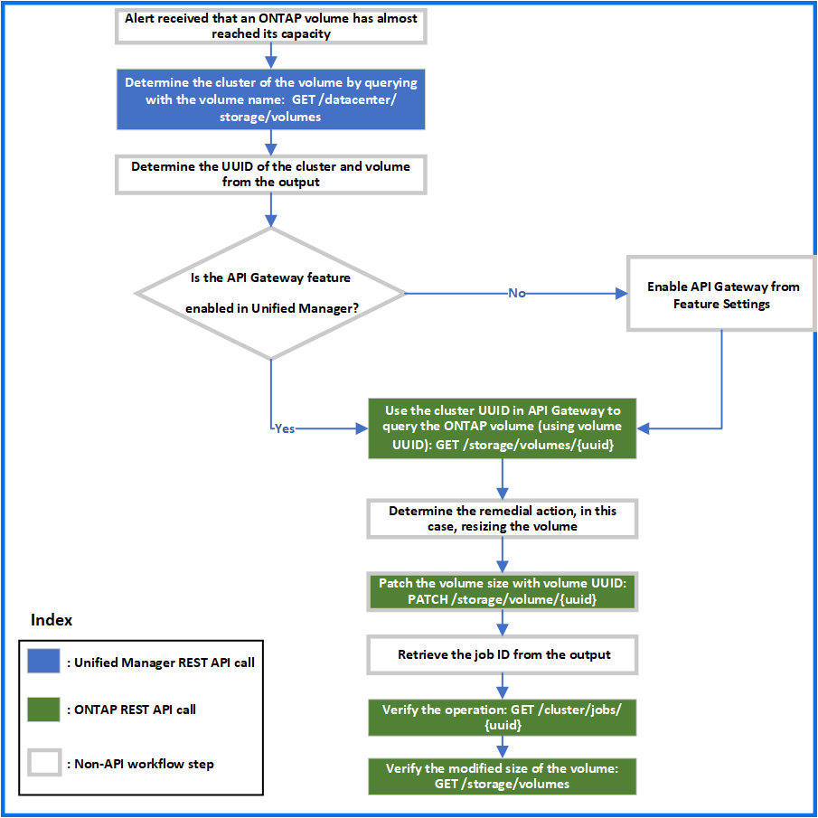

= Dépannez les volumes ONTAP à l'aide des API de passerelle Active IQ Unified Manager
:allow-uri-read: 
:icons: font
:imagesdir: ../media/

[role="lead"]
Les API de passerelle servent à invoquer les API ONTAP afin d’interroger des informations sur vos objets de stockage ONTAP et de prendre des mesures correctives pour résoudre les problèmes signalés.

Ce flux de travail illustre une utilisation dans laquelle un événement est déclenché lorsqu’un volume ONTAP atteint presque sa capacité maximale. Il montre également comment résoudre ce problème en combinant Active IQ Unified Manager et les API REST ONTAP.

[NOTE]
====
Avant d'exécuter les étapes du flux de travail, assurez-vous des points suivants :

* Vous connaissez les API de passerelle et leur mode d'utilisation. Pour plus d'informations, consultez link:concept_gateway_apis.html["Accès aux API ONTAP via un accès proxy"].
* Vous connaissez l'utilisation des API REST ONTAP. Pour plus d'informations sur l'utilisation des API REST ONTAP, consultez https://docs.netapp.com/us-en/ontap-automation/index.html["Documentation de l’automatisation ONTAP"].
* Vous êtes un administrateur d'applications.
* Le cluster sur lequel vous souhaitez exécuter les opérations de l'API REST est pris en charge avec ONTAP 9.5 ou version ultérieure, et le cluster est ajouté à Unified Manager via HTTPS.

====
Le diagramme suivant illustre chaque étape du flux de travail pour dépanner le problème d’utilisation de la capacité des volumes ONTAP.

Le flux de travail couvre les points d'invocation des API REST de Unified Manager et de ONTAP.

. Notez le nom du volume indiqué par l'événement signalant l'utilisation de la capacité du volume.
. En utilisant le nom du volume comme valeur dans le paramètre name, interrogez le volume en exécutant l'API Unified Manager suivante.
+
[cols="3*"]
|===
| Catégorie | Verbe HTTP | Chemin 

 a| 
centre de données
 a| 
GET
 a| 
`/datacenter/storage/volumes`

|===
. Récupérez l'UUID du cluster et l'UUID du volume à partir de la sortie.
. Dans l’interface utilisateur web de Unified Manager, accédez à *General* > *Feature Settings* > *API Gateway* pour vérifier si la fonctionnalité API Gateway est activée. Si ce n’est pas le cas, les API de la catégorie Gateway ne sont pas disponibles pour que vous les appeliez. Activez la fonctionnalité si elle est désactivée.
. Utilisez l’UUID du cluster pour exécuter l’API ONTAP /`storage/volumes/{uuid}` via la passerelle API. La requête renvoie les détails du volume lorsque l’UUID du volume est transmis comme paramètre d’API.
+
Pour exécuter les API ONTAP via la passerelle API, les informations d'identification de Unified Manager sont transmises en interne pour l'authentification, et vous n'avez pas besoin d'effectuer une étape d'authentification supplémentaire pour l'accès à chaque cluster.

+
[cols="3*"]
|===
| Catégorie | Verbe HTTP | Chemin 

 a| 
Unified Manager: passerelle

ONTAP : stockage
 a| 
GET
 a| 
API de passerelle: `/gateways/\{uuid}/\{path}`

API ONTAP : `/storage/volumes/\{uuid}`

|===
+
[NOTE]
====
Dans /gateways/\{uuid}/\{path}, la valeur de \{uuid} doit être remplacée par l'UUID du cluster sur lequel l'opération REST doit être effectuée. \{path} doit être remplacé par l'URL REST ONTAP /storage/volumes/\{uuid}.

====
+
L'URL ajoutée est : `/gateways/\{cluster_uuid}/storage/volumes/\{volume_uuid}`

+
Lors de l'exécution de l'opération GET, l'URL générée est: `GEThttps://<hostname\>/api/gateways/<cluster_UUID\>/storage/volumes/\{volume_uuid\}`

+
*Exemple de commande cURL*

+
[listing]
----
curl -X GET "https://<hostname>/api/gateways/1cd8a442-86d1-11e0-ae1c-9876567890123/storage/volumes/028baa66-41bd-11e9-81d5-00a0986138f7"
-H "accept: application/hal+json" -H "Authorization: Basic <Base64EncodedCredentials>"
----
. À partir des résultats, déterminez la taille, l'utilisation et la mesure corrective à prendre. Dans ce flux de travail, la mesure corrective consiste à redimensionner le volume.
. Utilisez l'UUID du cluster et exécutez l'API ONTAP suivante via la passerelle API pour redimensionner le volume. Pour plus d'informations sur les paramètres d'entrée des API de la passerelle et d'ONTAP, consultez l'étape 5.
+
[cols="3*"]
|===
| Catégorie | Verbe HTTP | Chemin 

 a| 
Unified Manager: passerelle

ONTAP : stockage
 a| 
CORRECTIF
 a| 
API de passerelle: `/gateways/\{uuid}/\{path}`

API ONTAP : `/storage/volumes/\{uuid}`

|===
+
[NOTE]
====
Outre l'UUID du cluster et l'UUID du volume, vous devez saisir une valeur pour le paramètre size afin de redimensionner le volume. Veillez à saisir la valeur _en octets_. Par exemple, si vous souhaitez augmenter la taille d'un volume de 100 Go à 120 Go, saisissez la valeur du paramètre size à la fin de la requête `-d {\"size\": 128849018880}"`.

====
+
*Exemple de commande cURL*

+
[listing]
----
curl -X PATCH "https://<hostname>/api/gateways/1cd8a442-86d1-11e0-ae1c-9876567890123/storage/volumes/028baa66-41bd-11e9-81d5-00a0986138f7" -H
    "accept: application/hal+json" -H "Authorization: Basic <Base64EncodedCredentials>" -d
    {\"size\": 128849018880}"
----
+
La sortie JSON renvoie un UUID de tâche.

. Vérifiez si la tâche s'est exécutée correctement à l'aide de l'UUID de la tâche. Utilisez l'UUID du cluster et l'UUID de la tâche pour exécuter l'API ONTAP suivante via la passerelle API. Pour plus d'informations sur les paramètres d'entrée de la passerelle et des API ONTAP, consultez l'étape 5.
+
[cols="3*"]
|===
| Catégorie | Verbe HTTP | Chemin 

 a| 
Unified Manager: passerelle

ONTAP : cluster
 a| 
GET
 a| 
API de passerelle: `/gateways/\{uuid}/\{path}`

API ONTAP : `/cluster/jobs/\{uuid}`

|===
+
Les codes HTTP renvoyés sont les mêmes que les codes d’état HTTP de l’API REST ONTAP.

. Exécutez l'API ONTAP suivante pour interroger les détails du volume redimensionné. Pour plus d'informations sur les paramètres d'entrée des API de la passerelle et de ONTAP, consultez l'étape 5.
+
[cols="3*"]
|===
| Catégorie | Verbe HTTP | Chemin 

 a| 
Unified Manager: passerelle

ONTAP : stockage
 a| 
GET
 a| 
API de passerelle: `/gateways/\{uuid}/\{path}`

API ONTAP : `/storage/volumes/\{uuid}`

|===
+
Le résultat affiche une taille de volume accrue de 120 Go.

