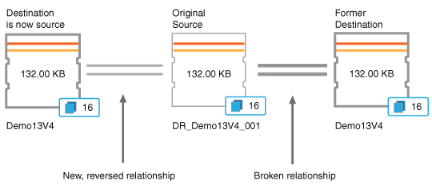

= Effectuez un basculement et un retour en arrière d'une relation de protection dans Active IQ Unified Manager
:allow-uri-read: 
:icons: font
:imagesdir: ../media/

[role="lead"]
Lorsqu'un volume source de votre relation de protection est désactivé en raison d'une défaillance matérielle ou d'une catastrophe, vous pouvez utiliser les fonctionnalités de relation de protection d'Unified Manager pour rendre la destination de protection accessible en lecture/écriture et basculer vers ce volume jusqu'à ce que la source soit de nouveau en ligne ; vous pouvez ensuite revenir à la source d'origine lorsqu'elle est disponible pour fournir des données.

.Avant de commencer
* Vous devez disposer du rôle Application Administrator ou Storage Administrator.
* Vous devez avoir configuré OnCommand Workflow Automation pour effectuer cette opération.

.Étapes
. link:task_break_snapmirror_relationship_from_health_volume_details.html["Rompre la SnapMirror relation"].
+
Vous devez rompre la relation avant de pouvoir convertir le volume de destination d’un volume de protection des données en un volume de lecture/écriture, et avant de pouvoir inverser la relation.

. link:task_reverse_protection_relationships_from_health_volume_details.html["Inverser la relation de protection"].
+
Lorsque le volume source d'origine est de nouveau disponible, vous pouvez rétablir la relation de protection initiale en restaurant le volume source. Avant de pouvoir restaurer la source, vous devez la synchroniser avec les données écrites sur l'ancienne destination. Vous utilisez l'opération de resynchronisation inverse pour créer une nouvelle relation de protection en inversant les rôles de la relation initiale et en synchronisant le volume source avec l'ancienne destination. Une nouvelle copie Snapshot de référence est créée pour la nouvelle relation.

+
La relation inversée ressemble à une relation en cascade :

+

. link:task_break_snapmirror_relationship_from_health_volume_details.html["Rompre la relation SnapMirror inversée"].
+
Lorsque le volume source d'origine est resynchronisé et peut à nouveau fournir des données, utilisez l'opération de rupture pour rompre la relation inversée.

. link:task_remove_protection_relationship_voldtls.html["Supprimer la relation"].
+
Lorsque la relation inversée n'est plus nécessaire, vous devez la supprimer avant de rétablir la relation d'origine.

. link:task_resynchronize_protection_relationships_voldtls.html["Resynchroniser la relation"].
+
Utilisez l'opération de resynchronisation pour synchroniser les données de la source vers la destination et rétablir la relation d'origine.

