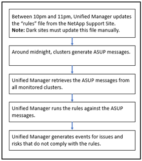

= Comment Active IQ Unified Manager génère des événements de la plateforme Active IQ
:allow-uri-read: 
:icons: font
:imagesdir: ../media/

[role="lead"]
Les incidents et les risques de la plateforme Active IQ sont convertis en événements Unified Manager, comme illustré dans le diagramme suivant.

Comme vous pouvez le constater, le fichier de règles compilé sur la plateforme Active IQ est maintenu à jour, les messages AutoSupport du cluster sont générés quotidiennement, et Unified Manager met à jour la liste des événements chaque jour.
