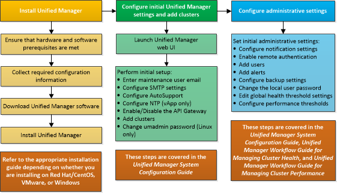

= Consultez la séquence d'installation de Active IQ Unified Manager
:allow-uri-read: 
:icons: font
:imagesdir: ../media/

[role="lead"]
Le processus d'installation décrit les tâches que vous devez effectuer avant de pouvoir utiliser Unified Manager.

Ces sections décrivent chacun des éléments présentés dans le flux de travail ci-dessous.

