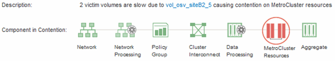

= Analyser un événement de performance MetroCluster sur un cluster dans Active IQ Unified Manager
:allow-uri-read: 
:icons: font
:imagesdir: ../media/

[role="lead"]
Vous pouvez utiliser Unified Manager pour analyser le cluster dans une configuration MetroCluster où un événement de performance a été détecté. Vous pouvez identifier le nom du cluster, l'heure de détection de l'événement et les workloads _bully_ et _victim_ impliqués.

.Avant de commencer
* Vous devez avoir le rôle Operator, Application Administrator ou Storage Administrator.
* Une configuration MetroCluster doit comporter des événements de performance nouveaux, reconnus ou obsolètes.
* Les deux clusters de la configuration MetroCluster doivent être surveillés par la même instance d'Unified Manager.

.Étapes
. Consultez la page *Détails de l'événement* pour obtenir des informations sur l'événement.
. Consultez la description de l'événement pour voir les noms des workloads concernés et le nombre de workloads concernés.
+
Dans cet exemple, l’icône Ressources MetroCluster est rouge, ce qui indique que les ressources MetroCluster sont en conflit. Vous placez votre curseur sur l’icône pour afficher une description de l’icône.

+

. Notez le nom du cluster et l'heure de détection de l'événement, que vous pourrez utiliser pour analyser les événements de performance sur le cluster partenaire.
. Dans les graphiques, examinez les workloads _victimes_ pour confirmer que leurs temps de réponse sont supérieurs au seuil de performance.
+
Dans cet exemple, le workload victime s'affiche dans le texte de survol. Les graphiques de latence présentent, à un niveau élevé, un profil de latence cohérent pour les workloads victimes concernés. Bien que la latence anormale des workloads victimes ait déclenché l'événement, un profil de latence cohérent peut indiquer que les workloads fonctionnent dans la plage attendue, mais qu'un pic d'E/S a augmenté la latence et déclenché l'événement.

+
image::../media/opm_mcc_incident_victim_workloads_png.gif[Workloads victimes dans l'événement de performance pour la configuration MetroCluster]

+
Si vous avez récemment installé une application sur un client qui accède à ces workloads de volume et que cette application leur envoie un volume important d'E/S, vous pourriez vous attendre à une augmentation de leur latence. Si la latence des workloads revient dans la plage attendue, que l'état de l'événement passe à « obsolète » et y reste pendant plus de 30 minutes, vous pouvez probablement ignorer l'événement. Si l'événement est toujours en cours et reste dans le nouvel état, vous pouvez approfondir l'analyse afin de déterminer si d'autres problèmes en sont la cause.

. Dans le graphique de débit du workload, sélectionnez *Bully Workloads* pour afficher les workloads dominants.
+
La présence de workloads perturbateurs indique que l'événement pourrait avoir été causé par un ou plusieurs workloads sur le cluster local qui surutilisent les ressources MetroCluster. Les workloads perturbateurs présentent un écart élevé dans le débit d'écriture (Mo/s).

+
Ce graphique présente, de manière générale, le profil de débit d'écriture (Mo/s) des workloads. Vous pouvez analyser le profil en Mo/s d'écriture pour identifier un débit anormal, ce qui pourrait indiquer qu'un workload surutilise les ressources MetroCluster.

+
Si aucune charge de travail excessive n'est impliquée dans l'événement, celui-ci peut être dû à un problème d'intégrité de la liaison entre les clusters ou à un problème de performance sur le cluster partenaire. Vous pouvez utiliser Unified Manager pour vérifier l'intégrité des deux clusters dans une configuration MetroCluster. Vous pouvez également utiliser Unified Manager pour rechercher et analyser les événements de performance sur le cluster partenaire.

