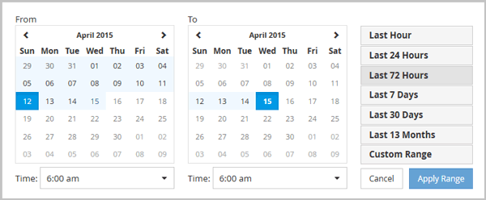

= Spécifiez une plage horaire personnalisée dans Active IQ Unified Manager
:allow-uri-read: 
:icons: font
:imagesdir: ../media/

[role="lead"]
La page Explorateur de performances vous permet de spécifier la plage de dates et d'heures de vos données de performances. La spécification d'une plage horaire personnalisée offre une plus grande flexibilité que l'utilisation de plages horaires prédéfinies lors de l'affinage des données d'objets de cluster.

Vous pouvez sélectionner une plage horaire comprise entre une heure et 390 jours. 13 mois correspondent à 390 jours, car chaque mois est compté comme 30 jours. Le fait de spécifier une plage de dates et d’heures fournit davantage de détails et vous permet de zoomer sur des événements de performance spécifiques ou des séries d’événements. Le fait de spécifier une plage horaire facilite également le dépannage de problèmes de performance potentiels, car la spécification d’une plage de dates et d’heures affiche avec plus de précision les données entourant l’événement de performance. Utilisez la commande *Time Range* pour sélectionner des plages de dates et d’heures prédéfinies, ou spécifiez votre propre plage de dates et d’heures personnalisée, jusqu’à 390 jours. Les boutons des plages horaires prédéfinies vont de *Last Hour* à *Last 13 Months*.

La sélection de l’option « 13 derniers mois » ou la spécification d’une plage de dates personnalisée supérieure à 30 jours affiche une boîte de dialogue vous avertissant que les données de performance affichées pour une période supérieure à 30 jours sont représentées sous forme de graphiques à l’aide de moyennes horaires et non de données collectées toutes les 5 minutes. Par conséquent, une perte de granularité visuelle de la chronologie peut se produire. Si vous cliquez sur l’option « Ne plus afficher » dans la boîte de dialogue, le message n’apparaît pas lorsque vous sélectionnez l’option « 13 derniers mois » ou spécifiez une plage de dates personnalisée supérieure à 30 jours. Les données récapitulatives s’appliquent également à une plage de temps plus réduite si celle-ci inclut une heure/date remontant à plus de 30 jours par rapport à aujourd’hui.

Lors de la sélection d'une période (personnalisée ou prédéfinie), les périodes de 30 jours ou moins sont basées sur des échantillons de données à intervalles de 5 minutes. Les périodes supérieures à 30 jours sont basées sur des échantillons de données à intervalles d'une heure.

. Cliquez sur la liste déroulante *Plage horaire* pour afficher le panneau Plage horaire.
. Pour sélectionner une plage de temps prédéfinie, cliquez sur l’un des boutons *Last...* à droite du panneau *Time Range*. Lorsque vous sélectionnez une plage de temps prédéfinie, les données sur une période pouvant aller jusqu’à 13 mois sont disponibles. Le bouton de plage de temps prédéfinie que vous avez sélectionné est mis en surbrillance, et les jours et l’heure correspondants s’affichent dans les calendriers et les sélecteurs d’heure.
. Pour sélectionner une plage de dates personnalisée, cliquez sur la date de début dans le calendrier *De* à gauche. Cliquez sur *<* or *>* pour avancer ou reculer dans le calendrier. Pour spécifier la date de fin, cliquez sur une date dans le calendrier *À* à droite. Notez que la date de fin par défaut est aujourd'hui, sauf si vous spécifiez une autre date de fin. Le bouton *Plage personnalisée* à droite du panneau Plage de dates est mis en surbrillance, ce qui indique que vous avez sélectionné une plage de dates personnalisée.
. Pour sélectionner une plage horaire personnalisée, cliquez sur la commande *Heure* sous le calendrier *De* et sélectionnez l’heure de début. Pour spécifier l’heure de fin, cliquez sur la commande *Heure* sous le calendrier *À* situé à droite et sélectionnez l’heure de fin. Le bouton *Plage personnalisée* à droite du panneau Plage horaire est mis en surbrillance, ce qui indique que vous avez sélectionné une plage horaire personnalisée.
. Vous pouvez également spécifier les heures de début et de fin lors de la sélection d'une plage de dates prédéfinie. Sélectionnez la plage de dates prédéfinie comme indiqué précédemment, puis sélectionnez les heures de début et de fin comme indiqué précédemment. Les dates sélectionnées sont mises en surbrillance dans les calendriers, les heures de début et de fin que vous avez spécifiées s'affichent dans les commandes *Heure*, et le bouton *Plage personnalisée* est mis en surbrillance.
. Après avoir sélectionné la plage de dates et d'heures, cliquez sur *Appliquer la plage*. Les statistiques de performance pour cette plage horaire s'affichent dans les graphiques et dans la chronologie des événements.

