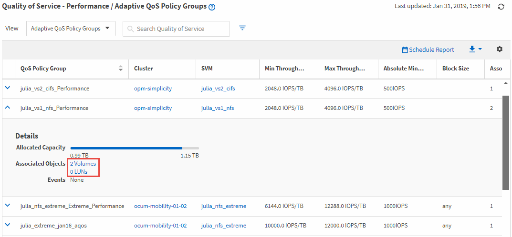

= Afficher les volumes ou les LUN appartenant au même groupe de stratégie QoS dans Active IQ Unified Manager
:allow-uri-read: 
:icons: font
:imagesdir: ../media/

[role="lead"]
Vous pouvez afficher la liste des volumes et des LUN attribués au même groupe de stratégie QoS.

Dans le cas des groupes de règles QoS traditionnels qui sont "`shared`" entre plusieurs volumes, cela peut être utile pour vérifier si certains volumes utilisent de façon excessive le débit défini pour le groupe de règles. Cela peut également vous aider à déterminer si vous pouvez ajouter d'autres volumes au groupe de règles sans impact négatif sur les autres volumes.

Dans le cas des règles de QoS adaptatives et des règles Unified Manager Performance Service Levels, il peut être utile d’afficher tous les volumes ou LUN qui utilisent un groupe de règles afin de voir quels objets seraient affectés si vous modifiiez les paramètres de configuration de la règle de QoS.

.Étapes
. Dans le volet de navigation de gauche, cliquez sur *Stockage* > *Groupes de stratégies QoS*.
+
La vue Performance: Traditional QoS Policy Groups s’affiche par défaut.

. Si vous vous intéressez au groupe de stratégies traditionnel, restez sur cette page. Sinon, sélectionnez l'une des options d'affichage supplémentaires pour afficher tous les groupes de stratégies QoS adaptatifs ou tous les groupes de stratégies QoS créés par Unified Manager Performance Service Levels.
. Dans la politique QoS qui vous intéresse, cliquez sur le bouton d’extension (image:../media/chevron_down.gif["icône du bouton d'expansion"]) à côté du nom du groupe de politiques QoS pour afficher plus de détails.
. Cliquez sur le lien Volumes ou LUNs pour afficher les objets utilisant cette politique QoS.
+
La page d'inventaire des performances pour les volumes ou les LUN affiche la liste triée des objets qui utilisent la politique QoS.

