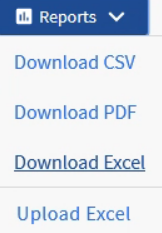

= Créez un rapport pour afficher les agrégats présentant le plus grand nombre d'IOPS disponibles dans Active IQ Unified Manager
:allow-uri-read: 
:icons: font
:imagesdir: ../media/

[role="lead"]
Ce rapport indique quels agrégats disposent du plus grand nombre d'IOPS disponibles par type d'agrégat et sur lesquels vous pouvez provisionner de nouvelles charges de travail.

.Avant de commencer
* Vous devez disposer du rôle Application Administrator ou Storage Administrator.

Suivez les étapes suivantes pour ouvrir une vue « Health: All Volumes », télécharger la vue dans Excel, créer un graphique de capacité disponible, téléverser le fichier Excel personnalisé et planifier le rapport final.

.Étapes
. Dans le volet de navigation de gauche, cliquez sur *Stockage* > *Agrégats*.
. Sélectionnez *Performances : Tous les agrégats* dans le menu déroulant *Affichage*.
. Sélectionnez *Afficher/Masquer* pour afficher la colonne  `Available IOPS` et masquer les colonnes  `Cluster FQDN, Inactive Data Reporting,` et  `Threshold Policy`.
. Faites glisser et déposez les colonnes  `Available IOPS` et  `Free Capacity` à côté de la colonne  `Type`.
. Nommez et enregistrez la vue personnalisée `Available IOPS Per Aggr.`
. Sélectionnez *Reports* > *Download Excel*.
+

+
Selon votre navigateur, vous devrez peut-être cliquer sur *OK* pour enregistrer le fichier.

. Si nécessaire, cliquez sur *Activer la modification*.
. Dans Excel, ouvrez le fichier téléchargé.
. Sur la feuille de données, cliquez sur le petit triangle en haut à gauche de la feuille pour sélectionner la feuille entière.
. Dans l'onglet *Données*, sélectionnez *Trier* dans le menu `Sort & Filter area.`
. Définissez les niveaux de tri suivants :
+
.. Spécifiez le *Tri par* comme `Available IOPS` (IOPS), le *Tri sur* comme `Cell Values,` et l’*Ordre* comme `Largest to Smallest.`
.. Cliquez sur *Ajouter un niveau*.
.. Spécifiez *Tri par* comme `Type`, *Tri sur* comme `Cell Values,` et *Ordre* comme `Z to A.`
.. Cliquez sur *Ajouter un niveau*.
.. Spécifiez *Trier par* comme `Free Capacity (GB),` le *Tri sur* comme `Cell Values,` et l’*Ordre* comme `Largest to Smallest.`
.. Cliquez sur *OK*.

. Enregistrez et fermez le fichier Excel.
. Dans Unified Manager, sélectionnez *Rapports* > *Importer Excel*.
+
[NOTE]
====
Assurez-vous d'être dans la même vue que celle où vous avez téléchargé le fichier Excel.

====
. Sélectionnez le fichier Excel que vous avez modifié, dans ce cas-ci `performance-aggregates-<date>.xlsx.`
. Cliquez sur *Ouvrir*.
. Cliquez sur *Submit*.
+
Une coche apparaît à côté de l'élément de menu *Rapports* > *Importer Excel*.

+
image::../media/upload_excel.png[Capture d'écran de l'interface utilisateur montrant comment importer des fichiers excel dans les rapports.]

. Cliquez sur *Scheduled Reports*.
. Cliquez sur *Ajouter une planification* pour ajouter une nouvelle ligne à la page Planifications des rapports afin de définir les caractéristiques de la planification du nouveau rapport.
. Saisissez un nom pour la planification du rapport et remplissez les autres champs du rapport, puis cliquez sur la coche (image:../media/blue_check.gif[""]) à la fin de la ligne.
+
[NOTE]
====
Sélectionnez le format *XLSX* pour le rapport.

====
+
Le rapport est envoyé immédiatement à titre de test. Ensuite, le rapport est généré et envoyé par courriel aux destinataires indiqués, selon la fréquence spécifiée.

D’après les résultats présentés dans le rapport, vous pourriez envisager de provisionner les nouvelles charges de travail sur les agrégats disposant du plus grand nombre d’IOPS disponibles.
