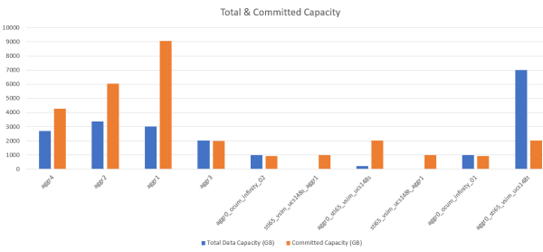

= Créez un rapport pour afficher un tableau et un graphique de capacité agrégée dans Active IQ Unified Manager
:allow-uri-read: 
:icons: font
:imagesdir: ../media/

[role="lead"]
Vous pouvez créer un rapport pour analyser la capacité dans un fichier Excel en utilisant les totaux additionnés et le format de graphique en colonnes groupées.

.Avant de commencer
* Vous devez disposer du rôle Application Administrator ou Storage Administrator.

Suivez les étapes suivantes pour ouvrir une vue Health: All Aggregates, télécharger la vue dans Excel, créer un graphique de capacité disponible, téléverser le fichier Excel personnalisé et planifier le rapport final.

.Étapes
. Dans le volet de navigation de gauche, cliquez sur *Stockage* > *Agrégats*.
. Sélectionnez *Reports* > *Download Excel*.
+
image::../media/download_excel_menu.png[Capture d'écran de l'interface utilisateur montrant comment télécharger un fichier Excel à partir des rapports.]

+
Selon votre navigateur, vous devrez peut-être cliquer sur *OK* pour enregistrer le fichier.

. Si nécessaire, cliquez sur *Activer la modification*.
. Dans Excel, ouvrez le fichier téléchargé.
. Créez une nouvelle feuille (image:../media/excel_new_sheet_icon.png[""]) après la `data` feuille et nommez-la *Total Data Capacity*.
. Ajoutez les colonnes suivantes dans la nouvelle feuille « Capacité totale des données » :
+
.. Capacité totale des données (Go)
.. Capacité engagée (GB)
.. Capacité de données utilisée (GB)
.. Capacité de données disponible (Go)

. Dans la première ligne de chaque colonne, saisissez la formule suivante, en veillant à ce qu'elle fasse référence à la feuille de données (data!) et aux spécificateurs de colonne et de ligne corrects pour les données capturées (Total Data Capacity extrait les données de la colonne E, lignes 2 à 20).
+
.. =SUM(data!E$2:data!E$20)
.. =SUM(data!F$2:data!F$50)
.. =SUM(data!G$2:data!G$50)
.. =SUM(data!H$2:data!H$50)

+
La formule calcule le total de chaque colonne en fonction des données actuelles.

image::../media/capacitysums.png[Capture d'écran de l'interface utilisateur d'une feuille de données affichant la capacité totale en fonction des données actuelles.]

. Sur la feuille de données, sélectionnez les colonnes *Capacité totale des données (Go)* et *Capacité engagée (Go)*.
. Sélectionnez *Graphiques recommandés* dans le menu *Insertion* et sélectionnez le graphique *Colonnes groupées*.
. Faites un clic droit sur le graphique et sélectionnez *Déplacer le graphique* pour déplacer le graphique vers la `Total Data Capacity` feuille.
. Les menus *Design* et *Format*, disponibles lorsque le graphique est sélectionné, vous permettent de personnaliser son apparence.
. Une fois satisfait(e), enregistrez le fichier avec vos modifications. Ne modifiez ni le nom ni l'emplacement du fichier.
+

. Dans Unified Manager, sélectionnez *Rapports* > *Importer Excel*.
+
[NOTE]
====
Assurez-vous d'être dans la même vue que celle où vous avez téléchargé le fichier Excel.

====
. Sélectionnez le fichier Excel que vous avez modifié.
. Cliquez sur *Ouvrir*.
. Cliquez sur *Submit*.
+
Une coche apparaît à côté de l'élément de menu *Rapports* > *Importer Excel*.

+
image::../media/upload_excel.png[Capture d'écran de l'interface utilisateur montrant comment importer des fichiers excel dans les rapports.]

. Cliquez sur *Scheduled Reports*.
. Cliquez sur *Ajouter une planification* pour ajouter une nouvelle ligne à la page Planifications des rapports afin de définir les caractéristiques de la planification du nouveau rapport.
+
[NOTE]
====
Sélectionnez le format *XLSX* pour le rapport.

====
. Saisissez un nom pour la planification du rapport et remplissez les autres champs du rapport, puis cliquez sur la coche (image:../media/blue_check.gif[""]) à la fin de la ligne.
+
Le rapport est envoyé immédiatement à titre de test. Ensuite, le rapport est généré et envoyé par courriel aux destinataires indiqués, selon la fréquence spécifiée.

Au vu des résultats présentés dans le rapport, il peut être utile d’examiner comment utiliser au mieux la capacité disponible sur l’ensemble de votre réseau.
