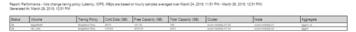

= Commencez à créer des rapports dans Active IQ Unified Manager
:allow-uri-read: 
:icons: font
:imagesdir: ../media/

[role="lead"]
Créez un exemple de rapport personnalisé pour vous familiariser avec l’exploration des vues et la planification des rapports. Ce rapport de démarrage rapide identifie une liste de volumes que vous pourriez vouloir déplacer vers le niveau cloud, car ils contiennent une quantité importante de données inactives (froides). Vous ouvrirez la vue Performance: All Volumes, la personnaliserez à l’aide de filtres et de colonnes, enregistrerez la vue personnalisée en tant que rapport et planifierez son partage une fois par semaine.

.Avant de commencer
* Vous devez disposer du rôle Application Administrator ou Storage Administrator.
* Vous devez avoir configuré des agrégats FabricPool et avoir des volumes sur ces agrégats.

Suivez les étapes ci-dessous pour :

* Ouvrez la vue par défaut
* Personnalisez les colonnes en filtrant et en triant les données
* Enregistrer la vue
* Planifiez la génération d'un rapport pour la vue personnalisée

.Étapes
. Dans le volet de navigation de gauche, cliquez sur *Stockage* > *Volumes*.
. Dans le menu Affichage, sélectionnez *Performances* > *Tous les volumes*.
. Cliquez sur *Afficher/Masquer* pour vous assurer que la colonne "`Types de disques`" apparaît dans la vue.
+
image::../media/show_hide_3.png[Capture d'écran de l'interface utilisateur montrant la liste déroulante du menu Afficher/Masquer.]

+
Ajoutez ou supprimez d'autres colonnes pour créer une vue contenant les champs importants pour votre rapport.

. Faites glisser la colonne « `Disk Types` » à côté de la colonne « `Cloud Recommendation` ».
. Cliquez sur l'icône de filtre pour ajouter les trois filtres suivants, puis cliquez sur *Appliquer le filtre*:
+
** Types de disques contient FabricPool
** La recommandation Cloud contient un niveau
** Données froides supérieures à 10 Go image:../media/filter_cold_data_2.png["Capture d'écran de l'interface utilisateur montrant comment appliquer un filtre à l'aide de l'option de filtre."]

+
Notez que chaque filtre est combiné avec un ET logique afin que tous les volumes renvoyés répondent à tous les critères. Vous pouvez ajouter jusqu'à cinq filtres.

. Cliquez en haut de la colonne « Données froides » pour trier les résultats afin que les volumes contenant le plus de données froides apparaissent en haut de la vue.
. Lorsque la vue est personnalisée, son nom est « Vue non enregistrée ». Nommez la vue de façon à refléter ce qu’elle affiche, par exemple « `Vols change tiering policy` ». Lorsque vous avez terminé, cliquez sur la coche ou appuyez sur *Enter* pour enregistrer la vue sous son nouveau nom.
+
image::../media/report_vol_code_data_2.png[Capture d'écran de l'interface utilisateur montrant la page Vols change tiering policy avec les colonnes requises dans le bon ordre.]

. Téléchargez le rapport au format *CSV*, *Excel* ou *PDF* pour visualiser le résultat avant de le programmer ou de le partager.
+
Ouvrez le fichier avec une application installée, telle que Microsoft Excel (CSV ou Excel) ou Adobe Acrobat (PDF), ou enregistrez le fichier.

+
[NOTE]
====
Vous pouvez personnaliser davantage votre rapport à l’aide de filtres complexes, de tris, de tableaux croisés dynamiques ou de graphiques en téléchargeant la vue sous forme de fichier Excel. Après avoir ouvert le fichier dans Excel, utilisez les fonctionnalités avancées pour personnaliser votre rapport. Lorsque vous êtes satisfait, téléchargez le fichier Excel. Ce fichier, avec ses personnalisations, est appliqué à la vue lors de l’exécution du rapport.

====
+
Pour plus d'informations sur la personnalisation des rapports à l'aide d'Excel, consultez _Exemples de rapports Microsoft Excel_.

. Cliquez sur le bouton *Rapports planifiés* sur la page d'inventaire. Tous les rapports planifiés relatifs à l'objet, ici les volumes, apparaissent dans la liste.
+
image::../media/scheduled_reports_3.gif[Capture d'écran de l'interface utilisateur montrant tous les rapports planifiés relatifs à l'objet.]

. Cliquez sur *Ajouter une planification* pour ajouter une nouvelle ligne à la page « Planifications des rapports » afin que vous puissiez définir les caractéristiques de la planification du nouveau rapport.
. Saisissez un nom pour le rapport et remplissez les autres champs du rapport, puis cliquez sur la coche (image:../media/blue_check.gif[""]) à la fin de la ligne.
+
Le rapport est envoyé immédiatement à titre de test. Ensuite, le rapport est généré et envoyé par courriel aux destinataires indiqués, selon la fréquence spécifiée.

+
Le rapport d'exemple suivant est au format CSV :

+
image::../media/csv_sample_report.gif[Capture d'écran de l'interface utilisateur montrant un exemple de rapport au format CSV.]

+
Le rapport d'exemple suivant est au format PDF :

+

En fonction des résultats présentés dans le rapport, vous pouvez utiliser ONTAP System Manager ou ONTAP CLI pour modifier la stratégie de hiérarchisation en « `auto` » ou « `all` » pour certains volumes afin de décharger davantage de données froides vers le niveau cloud.
