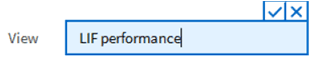

= Planifiez un rapport dans Active IQ Unified Manager
:allow-uri-read: 
:icons: font
:imagesdir: ../media/

[role="lead"]
Une fois que vous disposez d'une vue ou d'un fichier Excel que vous souhaitez programmer pour une génération et une distribution régulières, vous pouvez programmer le rapport.

.Avant de commencer
* Vous devez disposer du rôle Application Administrator ou Storage Administrator.
* Vous devez avoir configuré les paramètres du serveur SMTP sur la page *Général* > *Notifications* afin que le moteur de génération de rapports puisse envoyer des rapports sous forme de pièces jointes par e-mail à la liste des destinataires depuis le serveur Unified Manager.
* Le serveur de messagerie doit être configuré pour autoriser l’envoi de pièces jointes avec les e-mails générés.

Suivez les étapes ci-dessous pour tester et planifier la génération d'un rapport pour une vue donnée. Sélectionnez ou personnalisez la vue que vous souhaitez utiliser. La procédure suivante utilise une vue réseau qui affiche les performances de vos interfaces réseau, mais vous pouvez utiliser n'importe quelle vue de votre choix.

.Étapes
. Ouvrez la vue. Cet exemple utilise la vue réseau par défaut qui affiche les performances des LIF. Dans le volet de navigation de gauche, cliquez sur *Réseau > Interfaces réseau*.
. Personnalisez l’affichage selon vos besoins grâce aux fonctionnalités intégrées de Unified Manager.
. Après avoir personnalisé l'affichage, vous pouvez lui attribuer un nom unique dans le champ *View* et cliquer sur la coche pour l'enregistrer.
+

. Vous pouvez utiliser les fonctionnalités avancées de Microsoft® Excel pour personnaliser votre rapport. Pour plus de détails, consultez link:task_use_excel_to_customize_your_report.html["Utiliser Excel pour personnaliser votre rapport"].
. Pour visualiser le résultat avant de le programmer ou de le partager:
+
[cols="2*"]
|===
| Option | Description 

 a| 
*Si vous avez utilisé Excel pour personnaliser le rapport*
 a| 
Consultez le fichier Excel déjà téléchargé.

 a| 
*Si vous n'avez pas utilisé Excel pour personnaliser le rapport*
 a| 
Téléchargez le rapport au format *CSV*, *PDF* ou *XLSX*.

|===
+
Ouvrez le fichier avec une application installée, telle que Microsoft Excel (CSV/XSLX) ou Adobe Acrobat (PDF).

. Si le rapport vous convient, cliquez sur *Rapports programmés*.
. Sur la page « Planification des rapports », cliquez sur *Ajouter une planification*.
. Acceptez le nom par défaut, qui est une combinaison du nom de la vue et de la fréquence, ou personnalisez le *nom de la planification*.
. Pour tester le rapport programmé la première fois, ajoutez uniquement vous-même comme *destinataire*. Une fois satisfait, ajoutez les adresses électroniques de tous les destinataires du rapport.
. Indiquez la fréquence à laquelle le rapport sera généré et envoyé aux destinataires. Vous pouvez choisir *Daily*, *Weekly* ou *Monthly*.
. Sélectionnez le format, *PDF*, *CSV* ou *XSLX*.
+
[NOTE]
====
Pour les rapports dont vous avez personnalisé le contenu à l'aide d'Excel, sélectionnez toujours *XSLX*.

====
. Cliquez sur la coche (image:../media/blue_check.gif[""]) pour enregistrer la planification du rapport.
+
image::../media/scheduled_reports.gif[Capture d'écran de l'interface utilisateur montrant comment enregistrer la planification des rapports.]

+
Le rapport est envoyé immédiatement à titre de test. Ensuite, il est généré et envoyé par courriel aux destinataires indiqués selon la fréquence programmée.

