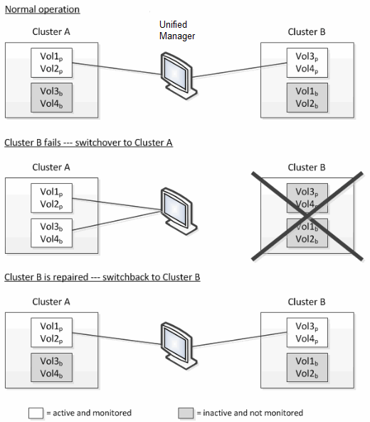
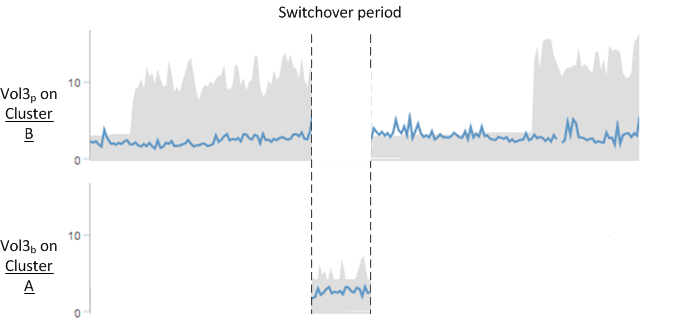

= Découvrez le comportement du volume lors des basculements et des retours en arrière dans Active IQ Unified Manager
:allow-uri-read: 
:icons: font
:imagesdir: ../media/

[role="lead"]
Les événements qui déclenchent un switchover ou un switchback entraînent le déplacement des volumes actifs d'un cluster à l'autre dans le groupe de reprise après sinistre. Les volumes du cluster qui étaient actifs et fournissaient des données aux clients sont arrêtés, tandis que les volumes de l'autre cluster sont activés et commencent à fournir des données. Unified Manager surveille uniquement les volumes qui sont actifs et en service.

Étant donné que des volumes sont déplacés d'un cluster à l'autre, il est recommandé de surveiller les deux clusters. Une seule instance de Unified Manager peut surveiller les deux clusters dans une configuration MetroCluster, mais la distance entre les deux emplacements nécessite parfois l'utilisation de deux instances de Unified Manager pour surveiller les deux clusters. La figure suivante montre une seule instance de Unified Manager :

Les volumes dont le nom contient un p indiquent les volumes principaux, et les volumes dont le nom contient un b sont des volumes de sauvegarde en miroir créés par SnapMirror.

En fonctionnement normal:

* Le cluster A comporte deux volumes actifs : Vol1p et Vol2p.
* Le cluster B comporte deux volumes actifs : Vol3p et Vol4p.
* Le cluster A comporte deux volumes inactifs : Vol3b et Vol4b.
* Le cluster B comporte deux volumes inactifs : Vol1b et Vol2b.

Unified Manager collecte les informations relatives à chaque volume actif (statistiques, événements, etc.). Les statistiques des volumes Vol1p et Vol2p sont collectées par Cluster A, et celles des volumes Vol3p et Vol4p par Cluster B.

Suite à une panne catastrophique entraînant un basculement des volumes actifs du Cluster B vers le Cluster A :

* Le cluster A comporte quatre volumes actifs : Vol1p, Vol2p, Vol3b et Vol4b.
* Le cluster B comporte quatre volumes inactifs : Vol3p, Vol4p, Vol1b et Vol2b.

Comme pendant le fonctionnement normal, Unified Manager collecte les informations relatives à chacun des volumes actifs. Mais dans ce cas, les statistiques de Vol1p et Vol2p sont collectées par Cluster A, et les statistiques de Vol3b et Vol4b sont également collectées par Cluster A.

Notez que Vol3p et Vol3b ne sont pas les mêmes volumes, car ils se trouvent sur des clusters différents. Les informations affichées dans Unified Manager pour Vol3p diffèrent de celles de Vol3b.

* Lors du basculement vers Cluster A, les statistiques et les événements Vol3p ne sont pas visibles.
* Dès le premier basculement, Vol3b apparaît comme un nouveau volume sans aucune information historique.

Une fois le Cluster B réparé et le basculement rétabli effectué, Vol3p est de nouveau actif sur le Cluster B, avec l'historique des statistiques et une absence de statistiques pour la période du basculement. Vol3b n'est pas visible depuis le Cluster A tant qu'un autre basculement ne se produit pas :

[NOTE]
====
* Les volumes MetroCluster inactifs, par exemple Vol3b sur le cluster A après switchback, sont identifiés par le message « `This volume was deleted` ». Le volume n'est pas réellement supprimé, mais il n'est pas actuellement surveillé par Unified Manager, car il ne s'agit pas du volume actif.
* Si un seul Unified Manager surveille les deux clusters dans une configuration MetroCluster, la recherche de volume renvoie les informations du volume actif à ce moment-là. Par exemple, une recherche sur « Vol3 » renverra les statistiques et les événements de Vol3b sur Cluster A si un basculement a eu lieu et que Vol3 est devenu actif sur Cluster A.

====