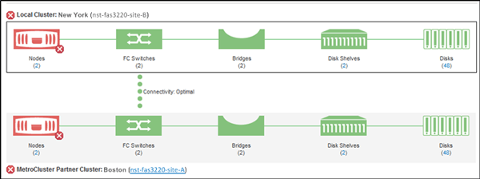

= Surveillez les configurations MetroCluster dans Active IQ Unified Manager
:allow-uri-read: 
:icons: font
:imagesdir: ../media/

[role="lead"]
Vous pouvez surveiller les problèmes de connectivité dans votre configuration MetroCluster. Les détails incluent l'état des composants et la connectivité au sein d'un cluster, ainsi que l'état de la connectivité entre les clusters dans la configuration MetroCluster. Vous découvrirez ici comment surveiller les problèmes de connectivité dans les clusters protégés par les configurations MetroCluster over FC et MetroCluster over IP.

Vous pouvez surveiller les configurations MetroCluster à partir des vues suivantes dans le volet de navigation gauche de Active IQ Unified Manager :

* *Stockage* > *Clusters* > *Protection : MetroCluster* vue
* *Protection* > *Relations* > *Relation : MetroCluster* vue

Unified Manager utilise des alertes d'état du système pour indiquer l'état des composants et de la connectivité dans la configuration MetroCluster.

.Avant de commencer
* Les clusters locaux et distants d'une configuration MetroCluster doivent tous deux être ajoutés à Active IQ Unified Manager.
* Dans une configuration MetroCluster sur IP, si un Mediator doit être pris en charge, il doit être configuré et ajouté au cluster via l'API correspondante.
* Vous devez avoir le rôle Operator, Application Administrator ou Storage Administrator.

[[monitor-connectivity-issues-in-metrocluster-over-fc-configuration]]
== Surveiller les problèmes de connectivité dans la configuration MetroCluster over FC

Pour les clusters dans une configuration MetroCluster sur FC, les graphiques de connectivité s'affichent sur la page de détails *Cluster / Health*. Suivez ces étapes.

.Étapes
. Dans le volet de navigation de gauche, cliquez sur *Stockage* > *Clusters*.
+
La liste de tous les clusters surveillés s'affiche.

. Dans la vue *Protection : MetroCluster*, cliquez sur le nom du cluster dont vous souhaitez afficher les détails de configuration MetroCluster over FC. Vous pouvez également filtrer par clusters dans une configuration MetroCluster.
. Sur la page de détails *Cluster / Santé*, cliquez sur l'onglet *MetroCluster Connectivity*. L'onglet *MetroCluster Connectivity* est disponible uniquement pour les configurations MetroCluster over FC.
+

+
La topologie de la configuration MetroCluster est affichée dans la zone de l'objet cluster correspondant. Vous pouvez utiliser les informations affichées sur la page Détails du cluster / état pour résoudre les problèmes de connectivité. Par exemple, si la connectivité entre le nœud et le commutateur d'un cluster est interrompue, l'icône suivante s'affiche :

image::../media/node_switch_connectivity.gif[icône de connectivité du commutateur de nœud]

Si vous déplacez le pointeur sur l'icône, vous pouvez consulter des informations détaillées sur l'événement généré.

Si vous découvrez des problèmes de connectivité dans votre configuration MetroCluster, vous devez vous connecter à System Manager ou accéder à l'ONTAP CLI pour résoudre ces problèmes.

Pour plus d'informations sur la détermination de l'état de santé du cluster, voir link:../health-checker/task_check_health_of_clusters_in_metrocluster_configuration.html#determine-cluster-health-in-metrocluster-over-fc-configuration["Déterminer l'état du cluster dans une configuration MetroCluster sur FC"].

[[monitor-connectivity-issues-in-metrocluster-over-ip-configuration]]
== Surveiller les problèmes de connectivité dans la configuration MetroCluster sur IP

Pour les clusters dans une configuration MetroCluster sur IP, les schémas de connectivité sont affichés sur la page *Clusters*. Suivez ces étapes.

.Étapes
. Dans le volet de navigation de gauche, cliquez sur *Stockage* > *Clusters*.
+
La liste de tous les clusters surveillés s'affiche.

. Dans la vue *Protection : MetroClusters*, cliquez sur le nom du cluster dont vous souhaitez afficher les détails de configuration de MetroCluster over IP. Vous pouvez également filtrer par clusters dans une configuration MetroCluster.
. Développez la ligne en cliquant sur l'icône `v` en forme de flèche. L'icône en forme de flèche n'apparaît que pour un cluster protégé par la configuration MetroCluster over IP.
+
Vous pouvez consulter la topologie des sites source et miroir, ainsi que le Mediator utilisé pour la connexion, le cas échéant. Vous pouvez consulter les informations suivantes :

+
** Connectivité entre les sites
** Problèmes d'état et de disponibilité, le cas échéant, sur les deux sites
** Problèmes liés au médiateur
** Problèmes liés à la réplication.
+

NOTE: Les statuts suivants sont signalés : Critique (image:sev_critical_um60.png[""]), Erreur (image:sev_error_um60.png[""]) ou Normal (image:sev_normal_um60.png[""]). Vous pouvez également consulter l’état global de la réplication des données primaires et miroir dans la même topologie.

+
Dans le diagramme suivant, vous pouvez constater que la connectivité intersite entre les clusters source et de destination est indisponible et que le Mediator entre eux n'est pas configuré.

+
image:mcc-ip-conn-status.png["Capture d'écran de l'interface utilisateur montrant la topologie des sites source et miroir, ainsi que le Mediator."]

. Cliquez sur l'icône d'état. Un message contenant la définition de l'erreur s'affiche. Si un événement a été déclenché pour ce problème dans votre configuration MetroCluster over IP, vous pouvez cliquer sur le bouton *Afficher l'événement* du message pour consulter les détails de l'événement. Une fois le problème et l'événement résolus, l'icône d'état de cette topologie retrouve son état normal (image:sev_normal_um60.png[""]).
. Vous pouvez afficher des détails de configuration supplémentaires dans les sections *MetroCluster Overview* et *Protection* de l'onglet *Configuration* de la page de détails *Cluster / Health*.

NOTE: Uniquement pour une configuration MetroCluster sur IP, vous pouvez afficher la topologie du cluster sur la page *Clusters*. Pour les clusters dans une configuration MetroCluster sur FC, la topologie s'affiche dans l'onglet *MetroCluster Connectivity* de la page de détails *Cluster / Health*.

*Informations connexes*

* link:../health-checker/reference_health_cluster_details_page.html["Page de détails Cluster / Santé"]
* Pour plus d'informations sur la vue *Relation :MetroCluster*, voir link:../storage-mgmt/task_monitor_metrocluster_configurations.html["Surveiller les configurations MetroCluster"].
* Pour plus d'informations sur la vue *Relation : État des transferts du dernier mois*, voir link:../data-protection/reference_relationship_last_1_month_transfer_status_view.html["Relation : affichage du statut des transferts du dernier mois"].
* Pour plus d'informations sur la vue *Relation : Taux de transfert du dernier mois*, voir link:../data-protection/reference_relationship_last_1_month_transfer_rate_view.html["Relation : vue du taux de transfert du dernier mois"].
* Pour plus d'informations sur la vue *Relations : Toutes les relations*, voir link:../data-protection/reference_relationship_all_relationships_view.html["Relation : vue Toutes les relations"].

